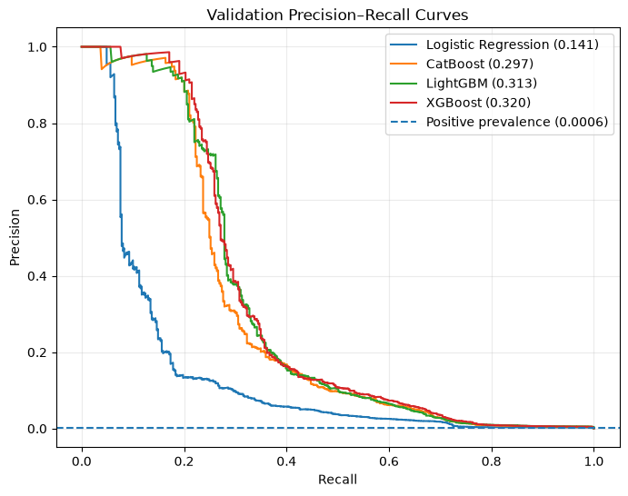
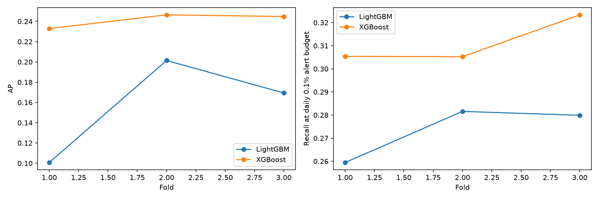

# AML


Для проекта используется синтетический IBM AML dataset. 


Цель - сделать end-to-end проект от исходного CSV до модели, списка алертов и dashboard.
## Как устроен проект


ETL превращает исходные транзакции в четыре временных набора данных. Затем в notebooks можно сравнить модели, подобрать параметры через Optuna и выбрать порог срабатывания. Ordered target encoding (OTE) исследуется отдельно; текущая ETL-команда сохраняет категории строками.

[Как работает ETL](docs/ETL.md) · [Что находится в датасете](docs/dataset.md) ·
[Полный отчёт об эксперименте](reports/full/RESULTS.md)
## Что получилось у модели
В сохранённом эксперименте лучшей по validation AP стала XGBoost.
| На отложенном test | Результат |
|---|---:|
| Average Precision | 0,3739 |
| Precision при выбранном пороге | 67,61% |
| Recall при выбранном пороге | 31,96% |
| Отправлено алертов | 355 |
| Из них действительно положительных | 240 |

То есть примерно два из трёх алертов оказались полезными, но модель нашла только около трети положительных транзакций. Это результат модели приоритизации; он пока недостаточен для полного покрытия отмывания.



На графике видно, как меняется precision при увеличении recall. Числа в легенде — validation AP; они отличаются от test AP в таблице выше.

Проверка на трёх временных окнах тоже дала преимущество XGBoost перед LightGBM:



Справа показан recall при дневном бюджете алертов 0,1%. Это другой эксперимент и другая политика алертов, поэтому его цифры нельзя напрямую сравнивать с таблицей test. [Условия и результаты backtest](reports/backtest/RESULTS.md).
## Запуск
Все команды ниже выполняются из корня репозитория. Нужны Python 3.13+ и uv.
### Установить зависимости
```bash
uv sync --locked --extra dev
```

### Получение данных
Сначала настройте Kaggle CLI, затем запустите загрузчик:
```bash
uv tool install kaggle
kaggle auth login
python3 scripts/download_dataset.py
```

Скрипт скачает только `LI-Small_Trans.csv` из [IBM AML dataset](https://www.kaggle.com/datasets/ealtman2019/ibm-transactions-for-anti-money-laundering-aml/data)и положит его в `data/raw/`. Если файл уже есть и проходит проверку заголовка,
повторная загрузка не понадобится.

Можно скачать CSV вручную. Другие способы авторизации, включая API token, описаны в [инструкции ETL](docs/ETL.md#откуда-взять-данные).
### Проверить ETL на небольшой выборке
```bash
uv run --locked python -m aml.cli.etl \
  --source data/raw/LI-Small_Trans.csv \
  --output artifacts/runs-smoke \
  --smoke
```

Режим `--smoke` оставляет каждую 50-ю строку. Он помогает проверить выполнение конвейера перед большим запуском. Отдельная папка сохраняет основной активный эксперимент без изменений.

Для полного запуска:
```bash
uv run --locked python -m aml.cli.etl \
  --source data/raw/LI-Small_Trans.csv \
  --output artifacts/runs
```

Команда выводит путь к новому run. В нём лежат подготовленные данные, timestamps и JSON с описанием источника и признаков. Маркер `SUCCESS` означает, что запись закончилась; `active.json` выбирает последний завершённый run.

Перед обучением XGBoost категории нужно закодировать. Этот шаг выполняется в исследовательском notebook 02; сама ETL-команда encoder пока не создаёт.
## Работа с notebooks
```bash
uv run --locked --extra dev python -m pytest -q
AML_RUN_DIR=artifacts/runs/full uv run --locked jupyter lab
```

Явный `AML_RUN_DIR` выбирает локальный сохранённый эксперимент. Его данные и веса не входят в Git; в свежем clone сначала нужно подготовить собственный run.

Notebooks идут в таком порядке:
|Notebook|Зачем запускать|
|---|---|
|`01_eda.ipynb` |Посмотреть данные и распределения в train|
|`02_feature_engineering.ipynb` |Построить признаки и сравнить кодирование категорий|
|`03_training.ipynb` |Обучить модели, подобрать параметры и выбрать лучшую|
|`04_evaluation.ipynb` |Выбрать порог на отдельном периоде и оценить test|
|`05_data_drift.ipynb` |Изучить изменения распределений признаков|
|`06_temporal_backtesting.ipynb` |Отдельно сравнить модели на временных окнах|

Новые эксперименты сохраняются в отдельные папки. Notebook 02 создаёт набор
данных, 03 — папку `training/<run_id>`, 04 и 05 — `evaluations/<run_id>`
и `drift/<run_id>`. Backtest сохраняется в `artifacts/backtests/`.
Указатели обновляются после успешного завершения соответствующего этапа.

## Где искать нужные файлы
```text
scripts/download_dataset.py # Скачать нужный CSV с Kaggle
src/aml/cli/etl.py           # Запустить ETL одной командой
src/aml/data/                # Чтение, проверка, split, transform и сохранение
src/aml/features/            # Базовые, исторические признаки и OTE encoder
src/aml/model/               # Обучение, метрики и функции backtest
src/aml/runs.py              # Создание запусков и указатели на артефакты
notebooks/                  # Анализ, обучение и оценка
tests/                      # Проверки данных, истории и записи результатов
docs/                       # Инструкции и описание данных
reports/                    # Сохранённые таблицы, графики и выводы
```

`data/` и `artifacts/` остаются локальными и исключены из Git. Зависимости зафиксированы в `uv.lock`; исходники, notebooks и отчёты можно публиковать. Резервные версии notebooks находятся локально в `artifacts/archive/`.


