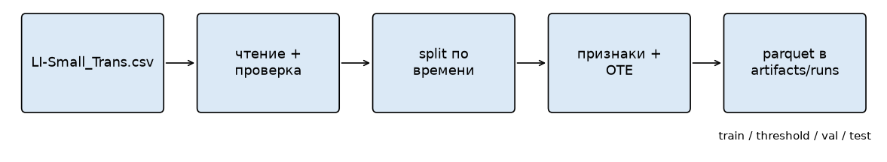
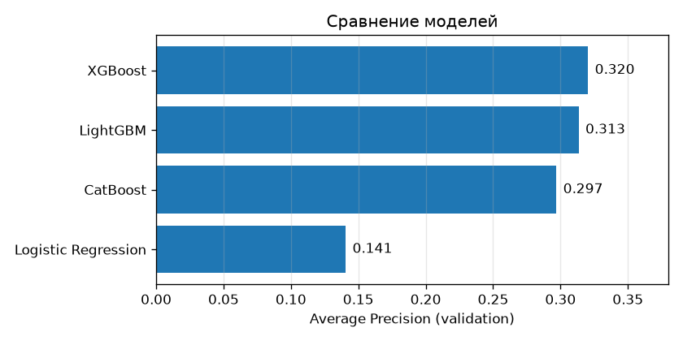
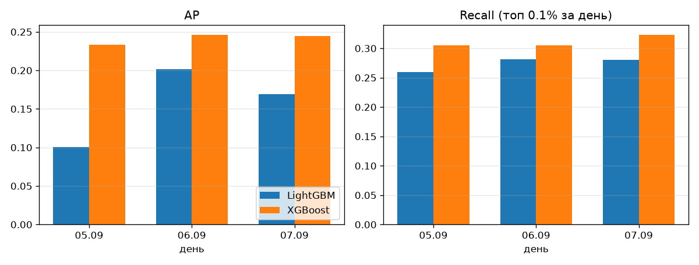

# AML

Учебный проект по поиску отмывания денег (anti-money laundering) в транзакциях. Данные синтетические, это IBM AML dataset с Kaggle, я брал файл `LI-Small_Trans.csv`.

Хотел пройти весь путь сам: от сырого CSV до модели, списка алертов и dashboard.

## Как устроено



Сначала ETL читает CSV, проверяет его, режет по времени на четыре части (train, threshold, val, test) и считает признаки. Категории кодируются через ordered target encoding (OTE). Encoder обучается только на train и сохраняется вместе с данными, чтобы не было утечки из будущего.

Дальше всё делается в notebooks: сравнение моделей, подбор параметров через Optuna и выбор порога.

Подробнее: [про ETL](docs/ETL.md), [про датасет](docs/dataset.md), [полный отчёт](reports/full/RESULTS.md).

## Результаты

Пробовал логистическую регрессию, CatBoost, LightGBM и XGBoost. Лучше всех на validation по AP получился XGBoost, хотя LightGBM совсем рядом:



На test (его модель не видела) у XGBoost вышло так:

| Метрика | Значение |
|---|---:|
| Average Precision | 0.374 |
| Precision | 67.6% |
| Recall | 32.0% |
| Алертов | 355 |
| Из них правда отмывание | 240 |

Примерно 2 из 3 алертов попадают в цель, это неплохо. Но находится только около трети всех подозрительных транзакций, остальные модель пропускает. Так что пока это скорее способ отсортировать транзакции по подозрительности, чем полноценный детектор.

Ещё я проверил XGBoost и LightGBM на трёх днях подряд (backtest). Тут алерты считаются по-другому: каждый день берётся топ 0.1% транзакций, поэтому с таблицей выше цифры сравнивать нельзя.



XGBoost выигрывает во все три дня, и у него меньше разброс. Детали в [отчёте по backtest](reports/backtest/RESULTS.md).

## Как запустить

Нужен Python 3.13+ и [uv](https://docs.astral.sh/uv/). Все команды запускаются из корня репозитория.

```bash
uv sync --locked --extra dev
```

### Данные

Скачиваются через Kaggle CLI:

```bash
uv tool install kaggle
kaggle auth login
python3 scripts/download_dataset.py
```

Скрипт качает только `LI-Small_Trans.csv` из [IBM AML dataset](https://www.kaggle.com/datasets/ealtman2019/ibm-transactions-for-anti-money-laundering-aml/data) и кладёт в `data/raw/`. Если файл уже лежит там, второй раз качать не будет. Можно и руками скачать. Про другие способы авторизации (например API token) написал в [docs/ETL.md](docs/ETL.md#откуда-взять-данные).

### ETL

Сначала лучше прогнать на маленьком куске, чтобы проверить, что всё работает:

```bash
uv run --locked python -m aml.cli.etl \
  --source data/raw/LI-Small_Trans.csv \
  --output artifacts/runs-smoke \
  --smoke
```

`--smoke` берёт каждый 50-й счёт отправителя со всей его историей. Папка отдельная, чтобы не испортить основной запуск.

Полный запуск:

```bash
uv run --locked python -m aml.cli.etl \
  --source data/raw/LI-Small_Trans.csv \
  --output artifacts/runs
```

В конце команда печатает путь к новому run. Там лежат данные, timestamps и json с описанием источника и признаков. Если появился файл `SUCCESS`, значит всё записалось до конца. `active.json` указывает на последний удачный run.

После этого можно сразу открывать notebook 03 и обучать модели. Notebook 02 не обязателен, там я просто сравнивал разные способы кодировать категории.

### Notebooks и тесты

```bash
uv run --locked --extra dev python -m pytest -q
AML_RUN_DIR=artifacts/runs/full uv run --locked jupyter lab
```

`AML_RUN_DIR` говорит notebooks, какой run брать. Данных и весов моделей в репозитории нет, так что после clone сначала надо прогнать ETL.

| Notebook | Что там |
|---|---|
| `01_eda.ipynb` | смотрю на данные и распределения в train |
| `02_feature_engineering.ipynb` | признаки и сравнение кодирования категорий |
| `03_training.ipynb` | обучение моделей, Optuna, выбор лучшей |
| `04_evaluation.ipynb` | выбор порога и проверка на test |
| `05_data_drift.ipynb` | как меняются признаки со временем |
| `06_temporal_backtesting.ipynb` | backtest на нескольких днях |

Каждый запуск сохраняется в свою папку: 02 создаёт новый набор данных, 03 пишет в `training/<run_id>`, 04 и 05 в `evaluations/<run_id>` и `drift/<run_id>`, backtest в `artifacts/backtests/`. Указатель на последний результат обновляется только если этап закончился без ошибок.

## Что где лежит

```text
scripts/download_dataset.py  # скачать CSV с Kaggle
src/aml/cli/etl.py           # запуск ETL
src/aml/data/                # чтение, проверка, split, сохранение
src/aml/features/            # признаки и OTE encoder
src/aml/model/               # обучение, метрики, backtest
src/aml/runs.py              # папки запусков и указатели
notebooks/                   # анализ, обучение, оценка
tests/                       # тесты
docs/                        # документация
reports/                     # сохранённые таблицы, графики и выводы
```

`data/` и `artifacts/` в git не попадают, они только локально. Версии библиотек зафиксированы в `uv.lock`.
