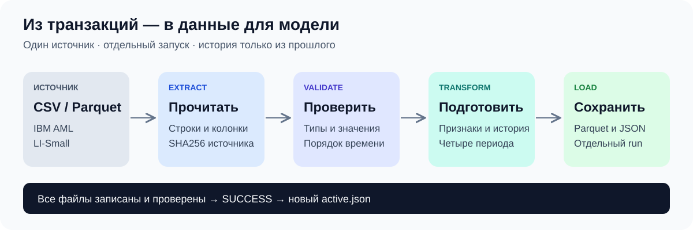
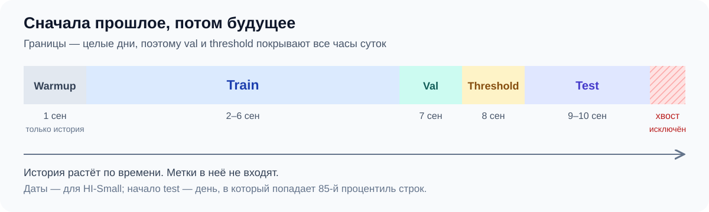
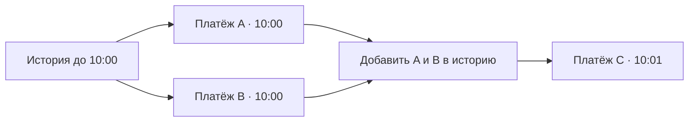
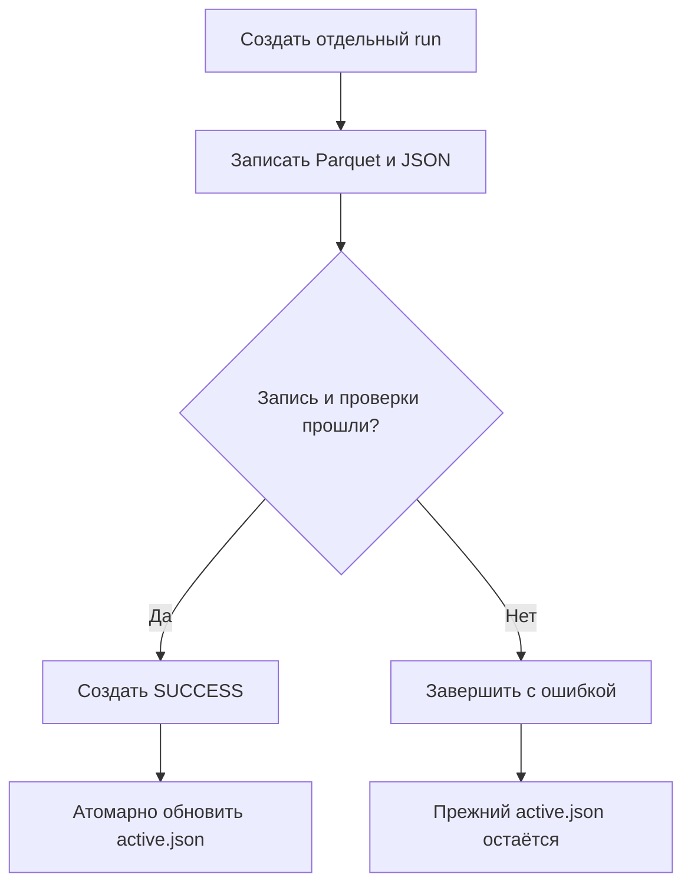

# Как работает ETL

ETL берёт исходные транзакции и подготавливает данные для обучения. Вместо ручного выполнения ячеек достаточно указать источник и папку результата. Конвейер прочитает файл, проверит значения, построит признаки и сохранит четыре временных набора.



Обучение модели, выбор порога и dashboard выполняются дальше, отдельными этапами.
## Откуда взять данные

Используется `LI-Small_Trans.csv` из
[IBM Transactions for Anti Money Laundering](https://www.kaggle.com/datasets/ealtman2019/ibm-transactions-for-anti-money-laundering-aml/data).

Из корня проекта выполните:

```bash
uv sync --locked --extra dev
uv tool install kaggle
kaggle auth login
python3 scripts/download_dataset.py
```

Загрузчик положит CSV в `data/raw/`. Он скачивает только нужный файл,
распаковывает ZIP при необходимости и проверяет заголовок с первой строкой.
Если скачивание оборвётся, незавершённый CSV не появится в конечной папке.
При повторном запуске существующий файл будет проверен и использован снова.

В исходном CSV могут быть два столбца с именем `Account`. Это ожидаемо:
pandas назовёт второй `Account.1`. Проверка заголовка не заменяет полную
валидацию таблицы — она выполняется на следующем этапе.

Другую папку можно указать так:

```bash
python3 scripts/download_dataset.py --output-dir /path/to/raw
```

По умолчанию загрузчик находит `data/raw/` относительно своего расположения,
поэтому его можно вызвать из другой рабочей папки.

Если браузерный вход неудобен, Kaggle поддерживает `KAGGLE_API_TOKEN`,
файл `~/.kaggle/access_token` и legacy credentials в `~/.kaggle/kaggle.json`.
Настройка описана в
[официальной инструкции](https://github.com/Kaggle/kaggle-cli/blob/main/docs/README.md#authentication).
Токены хранятся вне репозитория. Сам CSV можно скачать и вручную.

## Первый запуск

Начните с небольшой выборки:

```bash
uv run --locked python -m aml.cli.etl \
  --source data/raw/LI-Small_Trans.csv \
  --output artifacts/runs-smoke \
  --smoke
```

Здесь `--smoke` выбирает каждую 50-ю строку. Этого обычно достаточно, чтобы
проверить работу всех этапов. Отдельная папка `runs-smoke` позволяет
не переключать основной эксперимент.

Для обработки всех строк:

```bash
uv run --locked python -m aml.cli.etl \
  --source data/raw/LI-Small_Trans.csv \
  --output artifacts/runs
```

После установки проекта доступна и короткая команда `uv run --locked aml-etl`
с теми же аргументами. Вместо CSV можно передать raw Parquet через `--source`.
CLI читает именно указанный файл.

## Что происходит внутри

### Читаем источник

`extract.py` загружает нужные колонки и фиксирует, откуда пришли данные:
путь, формат, размер, SHA256 и число извлечённых строк. Хэш помогает сравнивать
источники разных запусков.

Номера счетов и банков из CSV читаются как строки. Иначе номер `000123`
может превратиться в `123`, и мы потеряем исходный идентификатор.
CSV читается частями; в smoke-режиме Parquet тоже читается пакетами.

### Проверяем транзакции

`validate.py` проверяет колонки, даты, пропуски, target и суммы.
Метки должны быть 0 или 1, суммы — конечными и неотрицательными.
После этого строки устойчиво сортируются по времени.

Дубликаты попадают в отчёт качества, но остаются в данных. В таблице нет
уникального ID транзакции: два одинаковых платежа могут быть реальными
операциями, поэтому удалять их автоматически было бы неверно.

### Строим признаки и делим данные

Базовые признаки описывают текущий платёж: время суток, день недели,
совпадение банков и валют, логарифмы сумм. Исторические признаки добавляют
контекст: сколько операций уже было у счёта, знакома ли пара отправитель–получатель,
сколько времени прошло с предыдущего платежа.

`split.py` делит таблицу на четыре периода:



Пропорции приблизительные: граница сдвигается к началу группы одинаковых
timestamps. Из-за этого группы остаются целыми, а фактические доли могут
отличаться от 70/10/5/15%.

Train нужен для обучения, validation — для выбора модели, threshold — для
выбора порога. Test остаётся последним периодом для итоговой оценки.

### Как используем историю

Представим, что у отправителя есть два платежа в 10:00 и один в 10:01.
Оба платежа в 10:00 получают признаки из истории до 10:00. Они не видят
друг друга. Платёж в 10:01 уже может использовать обе предыдущие операции.



Builder сначала обрабатывает train, затем последовательно validation,
threshold и test. Ранние транзакции нового периода могут участвовать в истории
его поздних транзакций. Их метки при этом не используются.

Метод `transform()` оставляет сохранённую историю неизменной, но учитывает
ранние строки переданного batch. `transform_update()` дополнительно сохраняет
batch для следующего вызова. Это последовательный расчёт истории, а не
замораживание всех статистик на конце train.

### Записываем результат

`load.py` проверяет согласованность X, y и timestamps, схему признаков и
временные границы. Затем создаёт отдельную папку и записывает Parquet и JSON.
После записи проверяется число сохранённых строк.



Таким образом, ошибка записи не переключит обучение на частично подготовленный
набор. Незавершённая папка может остаться для диагностики; маркера `SUCCESS`
в ней не будет.

## Что лежит в папке run

```text
artifacts/runs/
├── active.json
└── <UTC_timestamp_uuid>/
    ├── data/
    │   ├── train.parquet
    │   ├── train_time.parquet
    │   ├── val.parquet
    │   ├── val_time.parquet
    │   ├── threshold.parquet
    │   ├── threshold_time.parquet
    │   ├── test.parquet
    │   └── test_time.parquet
    ├── feature_schema.json
    ├── quality_report.json
    ├── data_manifest.json
    ├── configuration.json
    └── SUCCESS
```

В каждом split-файле находятся признаки и target `Is Laundering`.
Timestamp записывается отдельно, чтобы случайно не передать его модели.

| Файл | Что можно узнать |
|---|---|
| `feature_schema.json` | Какие признаки созданы и какие у них типы |
| `quality_report.json` | Сколько строк, пропусков, дубликатов и положительных меток |
| `data_manifest.json` | Какой источник использован и как разделены данные |
| `configuration.json` | Был ли включён smoke-режим |
| `SUCCESS` | Завершилась ли запись |
| `active.json` в родительской папке | Какой run выбран по умолчанию |

Повторный запуск создаёт новую папку, даже если исходный файл тот же.
Для чтения конкретного результата передайте его путь:

```python
from pathlib import Path
from aml.data.read import load_dataset_splits

splits = load_dataset_splits(
    input_dir=Path("artifacts/runs/<run_id>/data")
)
X_train, y_train = splits["train"]
```

Можно также выбрать run через `AML_RUN_DIR`. Папка smoke-запусков имеет
свой указатель и автоматически не заменяет основной.

## Где заканчивается текущая версия ETL

Категории пока остаются строками: encoder не создаётся. Для XGBoost потребуется
отдельный этап кодирования, обучаемый только на train. В исследовательских
notebooks эту работу выполняет notebook 02.

Исторический builder хранит прошлые строки и пересчитывает накопленную историю
на каждом split. На полном наборе из 6,9 млн транзакций это требует много RAM.
Состояние builder для последующего scoring новых batches пока не сохраняется.

Smoke полезен для проверки кода, но меняет историю счетов и распределение класса.
Метрики модели на такой выборке нельзя считать результатом полного эксперимента.
Если строк или различных timestamps слишком мало, один из периодов получится
пустым — конвейер остановится, сохранив временные группы целыми.

В датасете нет времени фактического получения событий и меток. Доступность
полей получения платежа при scoring остаётся допущением. Старый полный
эксперимент использовал локальный Parquet; его равенство скачанному CSV не проверено.

## Как проверить изменения

```bash
uv run --locked --extra dev python -m pytest -q
```

Загрузчик проверяется с имитацией Kaggle, без скачивания большого файла.
Тесты ETL проверяют временные границы, отсутствие доступа к будущим строкам,
сохранность данных после записи и поведение при сбое. После них стоит выполнить
smoke-run на реальном источнике.

[Вернуться к README](../README.md) · [Описание датасета](dataset.md)
