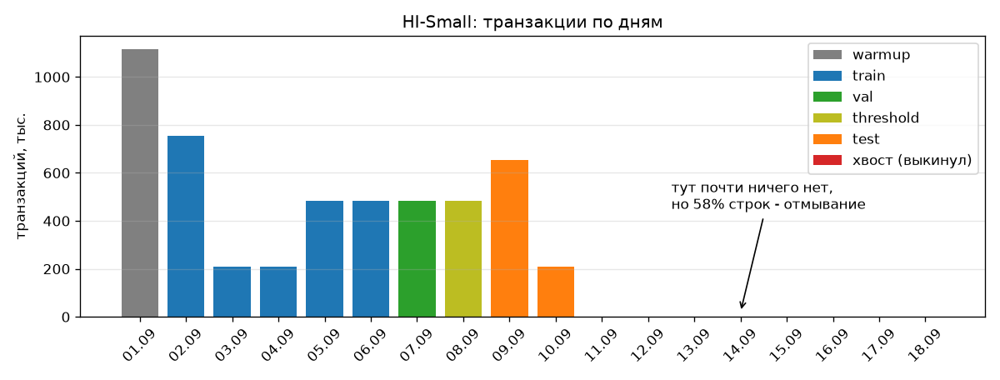
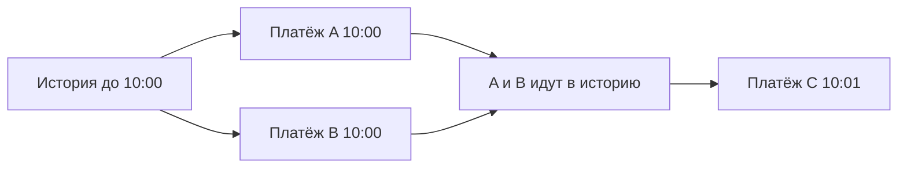
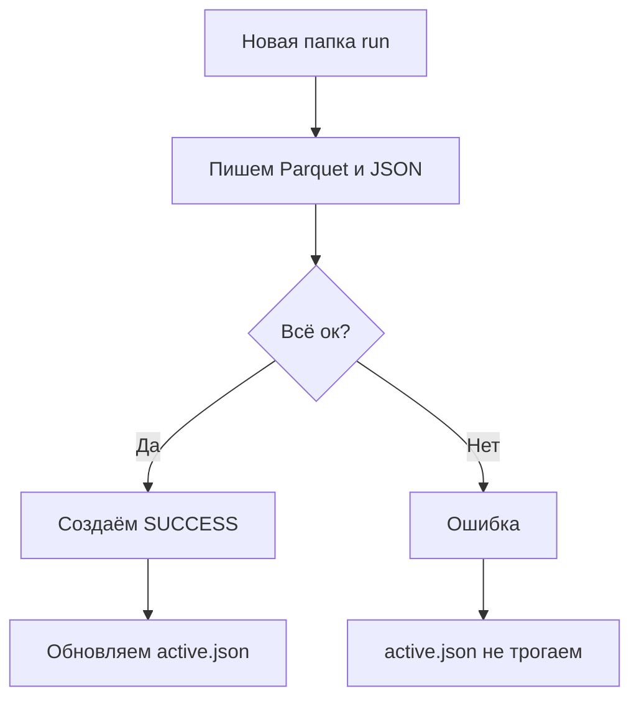

# ETL

ETL берёт сырой CSV с транзакциями и готовит из него данные для обучения. Раньше я делал это руками в ноутбуке, теперь это одна команда: указываешь файл и папку, куда сохранить. Внутри файл читается, проверяется, считаются признаки, кодируются категории, и всё сохраняется четырьмя кусками по времени.


Обучение, выбор порога и dashboard уже дальше, в ноутбуках.

## Откуда взять данные

Нужен файл `LI-Small_Trans.csv` из [IBM Transactions for Anti Money Laundering](https://www.kaggle.com/datasets/ealtman2019/ibm-transactions-for-anti-money-laundering-aml/data).

Из корня проекта:

```bash
uv sync --locked --extra dev
uv tool install kaggle
kaggle auth login
python3 scripts/download_dataset.py
```

Скрипт кладёт CSV в `data/raw/`. Он качает только этот один файл, сам распаковывает zip и проверяет заголовок и первую строку. Если загрузка оборвётся, недокачанный файл в папке не останется. Если файл уже скачан, второй раз он не качается.

В CSV две колонки называются `Account`, так и должно быть. pandas переименует вторую в `Account.1`. Проверка заголовка нужна только чтобы понять, что скачали правильный файл, нормальная проверка данных идёт потом.

Скачать в другую папку:

```bash
python3 scripts/download_dataset.py --output-dir /path/to/raw
```

Если не указывать, скрипт ищет `data/raw/` относительно себя, так что запускать можно из любой папки.

Если вход через браузер неудобен, у Kaggle есть другие способы: переменная `KAGGLE_API_TOKEN`, файл `~/.kaggle/access_token` или старый `~/.kaggle/kaggle.json`. Как это настроить, написано в [их инструкции](https://github.com/Kaggle/kaggle-cli/blob/main/docs/README.md#authentication). Токены в репозиторий не кладите. Ну и CSV всегда можно скачать руками.

## Запуск

Сначала лучше прогнать на маленькой выборке:

```bash
uv run --locked aml-etl \
  --source data/raw/LI-Small_Trans.csv \
  --output artifacts/runs-smoke \
  --smoke
```

`--smoke` берёт каждый 50-й счёт отправителя и все его транзакции. Сначала я брал просто каждую 50-ю строку, но тогда у счетов рвётся история и исторические признаки почти всегда нулевые, проверять так бессмысленно. Папка `runs-smoke` отдельная, чтобы не перезаписать основной запуск.

Полный запуск:

```bash
uv run --locked aml-etl \
  --source data/raw/LI-Small_Trans.csv \
  --output artifacts/runs
```

В `--source` можно передать и Parquet. Ещё есть флаги `--warmup-days N` (сколько дней отдавать под warmup) и `--keep-sparse-tail` (не выкидывать хвост, про него ниже). На HI-Small (5 млн строк) без OTE всё работало примерно 30 секунд, с OTE дольше.

## Что происходит внутри

### Чтение

`extract.py` читает CSV через pyarrow в несколько потоков, типы колонок заданы явно, время в формате `2022/09/01 00:20`. Заголовок проверяется до чтения: если какой-то колонки не хватает или есть лишняя, запуск падает. Номера счетов и банков читаются как строки, иначе `000123` превращается в `123`.

Для источника записывается путь, формат, размер, SHA256 и число строк.

### Проверка

`validate.py` падает, если есть пропуски, пустые ID, отрицательные или бесконечные суммы, метка не 0/1 или незнакомый формат платежа. Потом строки сортируются по времени (устойчивой сортировкой, чтобы порядок одинаковых timestamp не менялся).

Дубликаты я не удаляю, только считаю их в отчёте. ID транзакции в данных нет, и два одинаковых платежа вполне могут быть реальными. Ещё в отчёте есть количество строк и положительных по дням, частоты валют и форматов платежей.

### Разбиение по времени

`split.py` делит данные по целым дням:



| Период | HI-Small | Зачем |
|---|---|---|
| warmup | 1 сен | Только для истории. В первый день ни у кого нет прошлого, и модель бы это выучила |
| train | 2–6 сен | Обучение |
| val | 7 сен | Выбор модели и early stopping |
| threshold | 8 сен | Подбор порога для алертов |
| test | 9–10 сен | Финальная оценка |
| хвост | 11–18 сен | Выкидываю |

Val и threshold это целые сутки. Если подобрать порог, например, только на ночных часах, днём он работать не будет. Test начинается с дня, в который попадает 85-й процентиль строк.

Хвост это странность симулятора IBM. Обычные транзакции заканчиваются, а цепочки отмывания продолжаются. В HI-Small после 10 сентября остаётся 1108 строк, и 58% из них положительные (в остальных данных 0,1%). Если оценивать модель на таком хвосте, получится оценка генератора, а не модели. Хвостом считаю последние дни, где строк меньше 1% от медианного дня.

### Признаки

Всё собрано в `features/pipeline.py`, три шага. Метки здесь нигде не используются.

**Курсы валют.** Если платёж между разными валютами, то `paid · rate[pay] = received · rate[receive]`. `CurrencyConverter` берёт медиану по каждой паре валют на warmup + train и решает систему методом наименьших квадратов относительно доллара. Если какую-то валюту нельзя связать с долларом через пары, запуск падает. Подставлять курс 1 было бы хуже.

**Признаки самого платежа** (`basic.py`): час (и sin/cos от него), ночь или нет, совпадают ли банки и валюты, перевод самому себе, суммы в USD, отклонение от курса и насколько сумма круглая. День месяца, месяц и день недели я убрал: данных всего 10 дней, и эти признаки по сути говорят модели номер дня симуляции.

**История счетов** (`historical.py`). Берутся только транзакции, которые были строго раньше:

| Группа | Признаки |
|---|---|
| Активность за всё время | сколько было операций у отправителя, получателя и у пары; новая ли пара; сколько разных контрагентов; доля межбанковских платежей |
| Ритм | сколько минут прошло с прошлой операции; средний интервал у отправителя |
| Сумма | во сколько раз сумма больше обычной для отправителя и получателя |
| Окна 1 ч и 24 ч | количество и сумма операций; новые контрагенты (fan-out / fan-in) |
| Транзит | сколько пришло на счёт отправителя за окно; отношение «отправил / получил», у транзитных счетов около 1 |

### Как считается история

Пример: у отправителя два платежа в 10:00 и один в 10:01. Оба платежа в 10:00 видят только историю до 10:00, друг друга они не видят. Платёж в 10:01 уже видит оба.



История хранится как список событий, отсортированный по `(счёт, время)`. Для всего батча прошлые события находятся одним `searchsorted`, а суммы по окнам считаются как разность префиксных сумм. События старше 24 ч (самое длинное окно) сворачиваются в агрегаты по счёту. Поэтому памяти нужно немного: на HI-Small 91 МБ, а старая версия держала копию всех 5 млн строк. Префиксные суммы считаются отдельно для каждого счёта с компенсацией ошибки округления (TwoSum), иначе маленькая сумма может потеряться рядом с большими.

Сначала обрабатывается warmup + train, потом по очереди val, threshold и test. Ранние транзакции периода попадают в историю для поздних. В итоге получается то же самое, что за один проход по всем данным. Это проверяет тест, который сравнивает признаки с тупым пересчётом в лоб.

### Кодирование категорий

После признаков `OrderedTargetEncoder` превращает семь строковых категорий в числа. Для каждой категории и ещё четырёх комбинаций (банк + счёт отправителя, банк + счёт получателя, пара банков, пара валют) считается сглаженная доля положительных с коэффициентами 20 и 200 и логарифм числа наблюдений.

На train каждая строка видит только метки со строго более ранним временем. Строки с одинаковым timestamp метки друг друга не видят. Начальное значение 0. Warmup участвует в истории транзакций, но его метки в encoder не идут. Для val, threshold и test используется статистика по всему train, их метки encoder не обновляют. Кодирование делается до downsampling при обучении, чтобы статистика была по честному распределению train.

Параметры сглаживания и комбинации задаются в `EtlConfig` (`encoding_smoothing`, `encoding_interactions`) и пишутся в configuration.

Тут есть допущение: я считаю, что метки прошлого известны сразу. В реальности расследование занимает время, но в датасете этого нет.

### Сохранение

`load.py` проверяет, что X, y и timestamps совпадают по длине, схема признаков правильная, границы периодов не перепутаны, и что сохранённые строки вместе с warmup и хвостом дают весь исходный файл. Потом создаётся новая папка и туда пишутся Parquet и JSON. После записи ещё раз сверяется число строк.



То есть если что-то сломалось при записи, обучение не возьмёт недописанные данные. Сломанная папка может остаться, чтобы посмотреть что случилось, но `SUCCESS` в ней не будет.

## Что лежит в папке run

```text
artifacts/runs/
├── active.json
└── <UTC_timestamp_uuid>/
    ├── data/
    │   ├── train.parquet
    │   ├── train_time.parquet
    │   ├── val.parquet
    │   ├── val_time.parquet
    │   ├── threshold.parquet
    │   ├── threshold_time.parquet
    │   ├── test.parquet
    │   └── test_time.parquet
    ├── encoder.joblib
    ├── feature_pipeline.joblib
    ├── feature_schema.json
    ├── quality_report.json
    ├── data_manifest.json
    ├── configuration.json
    └── SUCCESS
```

В каждом файле split лежат признаки и target `Is Laundering`. Timestamp лежит отдельно, чтобы случайно не скормить его модели.

| Файл | Что там |
|---|---|
| `feature_pipeline.joblib` | курсы валют и история счетов на конец test, нужно для скоринга новых данных |
| `encoder.joblib` | OTE-статистика по train, применяется после feature pipeline |
| `feature_schema.json` | список признаков и их типы |
| `quality_report.json` | сколько строк, дубликатов, положительных, в том числе по дням |
| `data_manifest.json` | источник, границы периодов, сколько строк выкинули, курсы валют |
| `configuration.json` | smoke или нет, параметры периодов и окон |
| `SUCCESS` | запись прошла до конца |
| `active.json` (уровнем выше) | какой run брать по умолчанию |

Каждый запуск создаёт новую папку, даже если файл тот же. Загрузить конкретный run:

```python
from pathlib import Path
from aml.data.read import load_dataset_splits

splits = load_dataset_splits(
    input_dir=Path("artifacts/runs/<run_id>/data")
)
X_train, y_train = splits["train"]
```

Ноутбуки берут границы периодов из manifest через `aml.data.read.run_periods`, а не считают заново. Какой run брать, задаётся через `AML_RUN_DIR`. У smoke-запусков свой `active.json`, основной они не перебивают.

Новые транзакции после test можно прогнать через сохранённое состояние:

```python
import joblib
from aml.data.validate import validate_raw

pipeline = joblib.load("artifacts/runs/<run_id>/feature_pipeline.joblib")
encoder = joblib.load("artifacts/runs/<run_id>/encoder.joblib")
X_new = encoder.transform(pipeline.transform_update(validate_raw(new_transactions).df))
```

## Ограничения

- После ETL данные уже числовые, можно сразу идти в notebook 03. Notebook 02 не обязателен: там я заново собираю признаки с исходными категориями, чтобы сравнить CatBoost на сырых категориях и OTE.
- На HI-Small пиковая память около 6 ГБ. Это из-за строковых колонок в pandas (35 млн Python-строк), история тут ни при чём.
- Smoke нужен только чтобы проверить, что код работает. Распределение классов и связи между счетами там другие, так что метрики на нём ничего не значат.
- В данных нет времени, когда событие или метка реально стали известны. То, что поля получателя платежа доступны в момент скоринга, это допущение.
- Старый полный эксперимент делался на локальном Parquet. Я не проверял, что он совпадает с CSV, который скачивается сейчас.

## Тесты

```bash
uv run --locked --extra dev python -m pytest -q
```

Загрузчик тестируется с заглушкой вместо Kaggle, большой файл не качается. Тесты ETL проверяют границы периодов, что признаки не подсматривают в будущее, что исторические признаки совпадают с пересчётом в лоб (в том числе если подавать данные случайными батчами), что после записи ничего не теряется и что при ошибке `active.json` не меняется. После тестов стоит ещё прогнать smoke на настоящем файле.

[README](../README.md) · [Про датасет](dataset.md)
