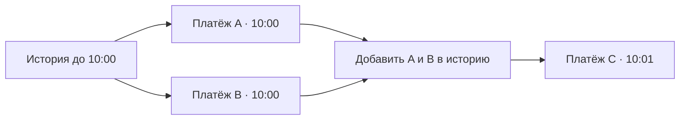
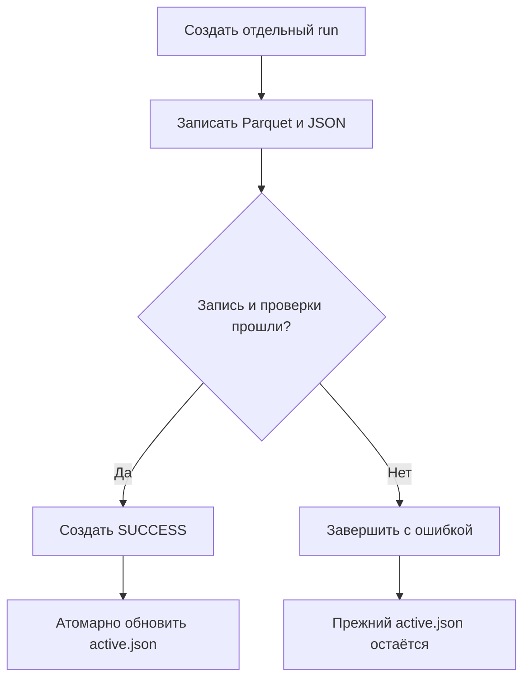

# Как работает ETL

ETL берёт исходные транзакции и подготавливает данные для обучения. Вместо ручного выполнения ячеек достаточно указать источник и папку результата. Конвейер прочитает файл, проверит значения, построит признаки, закодирует категории и сохранит четыре временных набора.


Обучение модели, выбор порога и dashboard выполняются дальше, отдельными этапами.
## Откуда взять данные

Используется `LI-Small_Trans.csv` из
[IBM Transactions for Anti Money Laundering](https://www.kaggle.com/datasets/ealtman2019/ibm-transactions-for-anti-money-laundering-aml/data).

Из корня проекта выполните:

```bash
uv sync --locked --extra dev
uv tool install kaggle
kaggle auth login
python3 scripts/download_dataset.py
```

Загрузчик положит CSV в `data/raw/`. Он скачивает только нужный файл,
распаковывает ZIP при необходимости и проверяет заголовок с первой строкой.
Если скачивание оборвётся, незавершённый CSV не появится в конечной папке.
При повторном запуске существующий файл будет проверен и использован снова.

В исходном CSV могут быть два столбца с именем `Account`. Это ожидаемо:
pandas назовёт второй `Account.1`. Проверка заголовка не заменяет полную
валидацию таблицы — она выполняется на следующем этапе.

Другую папку можно указать так:

```bash
python3 scripts/download_dataset.py --output-dir /path/to/raw
```

По умолчанию загрузчик находит `data/raw/` относительно своего расположения,
поэтому его можно вызвать из другой рабочей папки.

Если браузерный вход неудобен, Kaggle поддерживает `KAGGLE_API_TOKEN`,
файл `~/.kaggle/access_token` и legacy credentials в `~/.kaggle/kaggle.json`.
Настройка описана в
[официальной инструкции](https://github.com/Kaggle/kaggle-cli/blob/main/docs/README.md#authentication).
Токены хранятся вне репозитория. Сам CSV можно скачать и вручную.

## Первый запуск

Начните с небольшой выборки:

```bash
uv run --locked aml-etl \
  --source data/raw/LI-Small_Trans.csv \
  --output artifacts/runs-smoke \
  --smoke
```

`--smoke` оставляет все транзакции каждого 50-го счёта отправителя. Выборка
каждой 50-й строки разорвала бы историю счетов, и исторические признаки
проверялись бы на искусственно «пустых» клиентах. Отдельная папка `runs-smoke`
позволяет не переключать основной эксперимент.

Для обработки всех строк:

```bash
uv run --locked aml-etl \
  --source data/raw/LI-Small_Trans.csv \
  --output artifacts/runs
```

Вместо CSV можно передать raw Parquet через `--source`. Дополнительные флаги:
`--warmup-days N` задаёт длину warmup, `--keep-sparse-tail` отключает
исключение хвоста (см. ниже). На HI-Small (5 млн строк) полный запуск занимает
около 30 секунд до добавления OTE; кодирование увеличивает время обработки.

## Что происходит внутри

### Читаем источник

`extract.py` читает CSV через pyarrow: многопоточно, с явными типами колонок
и форматом времени `2022/09/01 00:20`. Заголовок проверяется до чтения данных:
второй `Account` получает имя `Account.1`, а лишняя или пропущенная колонка
останавливает запуск. Номера счетов и банков читаются строками, поэтому
`000123` не превращается в `123`.

Для источника фиксируются путь, формат, размер, SHA256 и число строк.

### Проверяем транзакции

`validate.py` отклоняет данные с пропусками, пустыми идентификаторами,
отрицательными или бесконечными суммами, небинарной меткой и неизвестным
форматом платежа. После этого строки устойчиво сортируются по времени.

Дубликаты попадают в отчёт качества, но остаются в данных. В таблице нет
уникального ID транзакции: два одинаковых платежа могут быть реальными
операциями. В отчёте также есть число строк и положительных меток по дням,
частоты валют и форматов.

### Делим на периоды


`split.py` режет время по целым дням:

| Период | HI-Small | Зачем |
|---|---|---|
| warmup | 1 сен | Только история счетов. В первый день у всех счетов нет прошлого, и модель выучила бы этот артефакт холодного старта |
| train | 2–6 сен | Обучение |
| val | 7 сен | Выбор модели и ранняя остановка |
| threshold | 8 сен | Выбор порога алертов |
| test | 9–10 сен | Итоговая оценка |
| хвост | 11–18 сен | Исключён |

Val и threshold — полные сутки: порог, подобранный на ночных часах, не перенёсся
бы на дневной трафик. Начало test — день, в который попадает 85-й процентиль
строк.

Хвост — особенность симулятора IBM: обычный трафик заканчивается, а
отмывочные цепочки продолжаются. В HI-Small после 10 сентября остаётся 1108
строк, из них 58% положительных против 0,1% в остальных данных. Оценка на таком
хвосте измеряла бы артефакт генератора. Хвостом считаются последние дни,
в которых строк меньше 1% от медианного дня.

### Строим признаки

`features/pipeline.py` объединяет три шага. Метки нигде не используются.

**Курсы валют.** Для платежа между валютами `paid · rate[pay] = received · rate[receive]`.
`CurrencyConverter` берёт медиану по каждой паре валют в warmup + train и решает
систему методом наименьших квадратов относительно доллара. Валюта, которую нельзя
связать с долларом через наблюдаемые пары, останавливает запуск, а не получает
курс 1.

**Признаки текущего платежа** (`basic.py`): час и его циклическое кодирование,
ночь, совпадение банков и валют, самоперевод, суммы в USD,
отклонение от курса и круглость суммы в исходной валюте. День месяца, месяц и
день недели исключены: на десяти днях данных они кодируют номер дня симуляции,
а не поведение.

**История счетов** (`historical.py`). Признаки строятся только по транзакциям со
строго более ранним временем:

| Группа | Признаки |
|---|---|
| Активность за всё время | число операций отправителя, получателя и пары; новая ли пара; число уникальных контрагентов; доля межбанковских платежей |
| Ритм | минуты с предыдущей операции; средний интервал между операциями отправителя |
| Аномалия суммы | сумма относительно средней прошлой у отправителя и у получателя |
| Окна 1 ч и 24 ч | число и сумма операций отправителя и получателя; новые контрагенты (fan-out / fan-in) |
| Транзит денег | поступления на счёт отправителя за окно; отношение «отправлено / получено» — около 1 у транзитных счетов |

### Как используем историю

Представим, что у отправителя есть два платежа в 10:00 и один в 10:01.
Оба платежа в 10:00 получают признаки из истории до 10:00. Они не видят
друг друга. Платёж в 10:01 уже может использовать обе предыдущие операции.



История хранится как журнал событий, отсортированный по ключу
`(счёт, время)`. Один `searchsorted` находит для всех строк батча прошлые
события их счёта, а оконные суммы считаются как разность префиксных сумм.
События старше самого длинного окна (24 ч) сворачиваются в агрегаты по счёту.
Поэтому состояние ограничено числом счетов и событиями последних суток: на
HI-Small это 91 МБ против копии всех 5 млн строк в прежней версии. Префиксные
суммы начинаются заново для каждого счёта и компенсируют ошибку округления
(TwoSum). Так маленькая сумма не теряется рядом с крупными платежами того же
счёта.

Builder обрабатывает warmup + train, затем последовательно val, threshold и test.
Ранние транзакции нового периода участвуют в истории его поздних транзакций.
Результат совпадает с одним проходом по всем данным; это проверяется тестом,
который сравнивает признаки с наивным пересчётом по определению.

### Кодируем категории

После построения признаков `OrderedTargetEncoder` заменяет семь строковых
категорий числовыми признаками. Для каждой категории и четырёх взаимодействий
(банк + счёт отправителя, банк + счёт получателя, пара банков, пара валют)
создаются сглаженные доли положительного класса с коэффициентами 20 и 200
и логарифм исторического числа наблюдений.

На train строка использует только метки со строго более ранним timestamp:
операции с одинаковым временем не видят меток друг друга. Начальный prior — 0.
Warmup даёт историю транзакций, но его метки не участвуют в encoder.
Val, threshold и test используют фиксированную статистику полного train.
Их метки не обновляют encoder. Кодирование выполняется до downsampling в обучении,
поэтому статистика соответствует исходному распределению train.

Параметры сглаживания и взаимодействия задаются через `EtlConfig`
(`encoding_smoothing`, `encoding_interactions`) и сохраняются в configuration.
Это офлайн-допущение: метки прошлого считаются доступными сразу; задержка
расследования в датасете не задана.

### Записываем результат

`load.py` проверяет согласованность X, y и timestamps, схему признаков,
временные границы и то, что сохранённые строки вместе с warmup и хвостом
покрывают весь источник. Затем создаёт отдельную папку и записывает Parquet и JSON.
После записи проверяется число сохранённых строк.



Таким образом, ошибка записи не переключит обучение на частично подготовленный
набор. Незавершённая папка может остаться для диагностики; маркера `SUCCESS`
в ней не будет.

## Что лежит в папке run

```text
artifacts/runs/
├── active.json
└── <UTC_timestamp_uuid>/
    ├── data/
    │   ├── train.parquet
    │   ├── train_time.parquet
    │   ├── val.parquet
    │   ├── val_time.parquet
    │   ├── threshold.parquet
    │   ├── threshold_time.parquet
    │   ├── test.parquet
    │   └── test_time.parquet
    ├── encoder.joblib
    ├── feature_pipeline.joblib
    ├── feature_schema.json
    ├── quality_report.json
    ├── data_manifest.json
    ├── configuration.json
    └── SUCCESS
```

В каждом split-файле находятся признаки и target `Is Laundering`.
Timestamp записывается отдельно, чтобы случайно не передать его модели.

| Файл | Что можно узнать |
|---|---|
| `feature_pipeline.joblib` | Курсы валют и история счетов на конец test — состояние для scoring новых батчей |
| `encoder.joblib` | OTE-статистика только train; применяется после feature pipeline |
| `feature_schema.json` | Какие признаки созданы и какие у них типы |
| `quality_report.json` | Сколько строк, дубликатов и положительных меток, в том числе по дням |
| `data_manifest.json` | Источник, границы периодов, число исключённых строк, курсы валют |
| `configuration.json` | Smoke-режим и параметры периодов и окон |
| `SUCCESS` | Завершилась ли запись |
| `active.json` в родительской папке | Какой run выбран по умолчанию |

Повторный запуск создаёт новую папку, даже если исходный файл тот же.
Для чтения конкретного результата передайте его путь:

```python
from pathlib import Path
from aml.data.read import load_dataset_splits

splits = load_dataset_splits(
    input_dir=Path("artifacts/runs/<run_id>/data")
)
X_train, y_train = splits["train"]
```

Notebooks получают границы периодов из manifest через
`aml.data.read.run_periods`, а не пересчитывают их. Run можно выбрать через
`AML_RUN_DIR`. Папка smoke-запусков имеет свой указатель и автоматически
не заменяет основной.

Новые транзакции, пришедшие после test, оцениваются сохранённым состоянием:

```python
import joblib
from aml.data.validate import validate_raw

pipeline = joblib.load("artifacts/runs/<run_id>/feature_pipeline.joblib")
encoder = joblib.load("artifacts/runs/<run_id>/encoder.joblib")
X_new = encoder.transform(pipeline.transform_update(validate_raw(new_transactions).df))
```

## Где заканчивается текущая версия ETL

Сохранённые splits содержат числовые признаки и готовы для notebook 03.
Notebook 02 необязателен: он восстанавливает признаки с исходными категориями
для сравнения native CatBoost и OTE, затем сохраняет отдельный эксперимент.

Пик памяти на HI-Small — около 6 ГБ. Его определяют строковые колонки pandas
(35 млн Python-строк), а не история.

Smoke полезен для проверки кода, но меняет распределение класса и связи между
счетами. Метрики модели на такой выборке нельзя считать результатом полного
эксперимента.

В датасете нет времени фактического получения событий и меток. Доступность
полей получения платежа при scoring остаётся допущением. Старый полный
эксперимент использовал локальный Parquet; его равенство скачанному CSV не проверено.

## Как проверить изменения

```bash
uv run --locked --extra dev python -m pytest -q
```

Загрузчик проверяется с имитацией Kaggle, без скачивания большого файла.
Тесты ETL проверяют временные границы, отсутствие доступа к будущим строкам,
совпадение исторических признаков с наивным пересчётом (в том числе при подаче
случайными батчами), сохранность данных после записи и поведение при сбое.
После них стоит выполнить smoke-run на реальном источнике.

[Вернуться к README](../README.md) · [Описание датасета](dataset.md)
