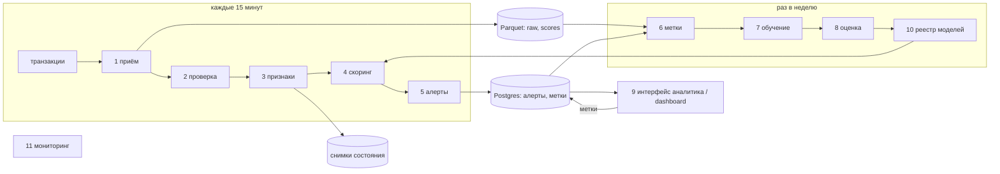

# Как это могло бы работать в проде

Сейчас проект это CSV → ETL → ноутбуки → модель. Здесь я записал, как, по-моему, из этого можно сделать систему, которая сама скорит транзакции, собирает очередь алертов для аналитиков, учится на их решениях и за которой можно следить. Это план, ничего из нового ниже ещё не сделано.

## Что должна уметь система

1. Принимать транзакции пачками по времени и проверять их (схема, диапазоны, форматы).
2. Считать признаки только по прошлому, без утечки из будущего.
3. Скорить каждую транзакцию текущей лучшей моделью (дальше «чемпион»).
4. Превращать скоры в очередь алертов ограниченного размера.
5. Давать аналитику отметить алерт и сохранять это как метку.
6. Переобучаться по расписанию или при дрейфе и менять чемпиона только если новая модель правда лучше.
7. Dashboard: очередь, сколько алертов, precision/recall, дрейф, версия модели.
8. Для любого старого скора можно восстановить, какие данные, признаки, модель и порог его дали.

Мои прикидки (их надо уточнять):

| Что | Сколько | Откуда взял |
|---|---|---|
| Объём | ~0.5 млн транзакций в день, в среднем ~6 в секунду, пик 60 | HI-Small: 5.08 млн строк за ~10 дней |
| Доля отмывания | ~0.1% | из датасета, в жизни скорее меньше |
| Задержка | алерт в течение 15 минут после транзакции | моё допущение, блокировать платежи в реальном времени не нужно |
| Алертов в день | фиксированный бюджет, например 0.1% (~500) | как в backtest |
| Доступность | 99% для скоринга | это проверка после факта, платежи не держим |
| Аудит | любой алерт можно отследить до модели, признаков и хэша данных | AML регулируется |
| Железо | одна машина или небольшая VM | данных немного |

Ограничения: Python 3.13, pandas/pyarrow/joblib, XGBoost/LightGBM/CatBoost, `uv`. Сейчас почти всё в ноутбуках. В данных нет ID транзакции и нет времени, когда пришла транзакция и когда пришла метка.

Не делаю: блокировку платежей в реальном времени, графовые модели, оформление SAR, поддержку нескольких банков-клиентов.

## Что уже есть

| Часть | Состояние | Где |
|---|---|---|
| Чтение, проверка, split | работает: pyarrow, хэш и число строк в manifest, отчёт качества, split по дням, хвост выкидывается | `src/aml/data/` |
| Признаки | работает: `FeaturePipeline` с `fit_transform` / `transform` / `transform_update`, есть тесты против пересчёта в лоб и случайных батчей | `features/pipeline.py`, `historical.py` |
| Сохранение run | отдельная папка, `SUCCESS`, атомарный `active.json` | `runs.py`, `data/load.py` |
| Кодирование категорий | OTE считается прямо в ETL, encoder сохраняется | `data/transform.py`, `features/encoding.py` |
| Обучение, порог, оценка | только в ноутбуках, в библиотеке пока только метрики и backtest | `model/` |
| Скоринг | `transform_update` есть, но обёртки encoder + модель + порог нет | нет |
| Алерты, метки от аналитиков | нет | нет |
| Мониторинг | дрейф только в notebook 05 | `monitoring/` |
| Dashboard | статический html, в git не лежит | нет |

Модель сейчас (XGBoost, HI-Small, test 9–10 сентября): AP 0.604, precision 78.4%, recall 51.7%, 630 алертов за 2 дня. В backtest с бюджетом 0.1% в день AP ~0.55, recall ~53%. То есть она ловит примерно половину, и **только в платежах ACH**: в других форматах на test она не нашла ни одного из 122 случаев. Это скорее помощь в сортировке, чем полноценный детектор, и система вокруг должна это учитывать (например, отдельные правила или модели для других форматов).

## Общая схема



Две части, которые работают с разной частотой:

- **Скоринг** (каждые 15 минут, для начала можно раз в день): принять → посчитать → выдать алерты. Повторный запуск на тех же данных даёт тот же результат.
- **Обучение** (раз в неделю или по сигналу): собрать данные из raw и созревших меток, обучить, проверить, решить, менять ли чемпиона.

Важно, что обе части используют один и тот же `FeaturePipeline`. Тогда признаки при обучении и при скоринге гарантированно считаются одинаково, и это уже есть.

| # | Компонент | Что делает | Есть? |
|---|---|---|---|
| 1 | Приём | сохраняет пачку как неизменяемый Parquet, пишет путь, SHA256, число строк, `batch_id` | `data/extract.py`, доделать |
| 2 | Проверка | плохие строки в карантин, отчёт качества, порядок по времени | `data/validate.py`, доделать |
| 3 | Признаки | `transform_update` на пачке, снимок состояния после успеха | `features/pipeline.py` |
| 4 | Скоринг | encoder → модель из пакета чемпиона, запись скоров | новое |
| 5 | Алерты | порог + лимит в день, без дублей, приоритет | новое |
| 6 | Метки | присоединить решения аналитиков к транзакциям с учётом задержки | новое |
| 7–8 | Обучение и оценка | перенести ноутбуки 02–04 и 06 в `aml-train`, `aml-evaluate` | ноутбуки → код |
| 9 | Интерфейс аналитика | очередь, кнопки решений, объяснения | новое, есть прототип |
| 10 | Реестр | версии пакетов и указатель на чемпиона | как в `runs.py` |
| 11 | Мониторинг | дрейф, объёмы, доля алертов, метрики с задержкой | notebook 05 → job |

## Подробнее

### Пакет модели

Нельзя, чтобы модель случайно запустилась с чужим encoder или состоянием признаков. Поэтому всё лежит вместе:

```text
artifacts/bundles/<bundle_id>/
├── feature_pipeline.joblib     # курсы валют и история счетов на момент T
├── encoder.joblib              # OTE, обучен только на train
├── model.json                  # XGBoost
├── feature_schema.json         # признаки по порядку и типы, хэш сверяется при загрузке
├── policy.json                 # порог, лимит в день, на каком периоде подбирали
├── lineage.json                # SHA256 исходников, id запусков ETL и обучения, git SHA, хэш lockfile
├── metrics.json                # val, threshold, test, backtest
└── SUCCESS
artifacts/bundles/champion.json # указатель на чемпиона, как active.json
```

- Скоринг не стартует, если хэш схемы не совпадает с тем, что выдаёт encoder или ждёт модель.
- `joblib` это pickle, при загрузке может выполниться любой код. Поэтому грузим только из реестра и сверяем SHA256 каждого файла с `lineage.json`.
- Сам пакет не меняется. Состояние признаков, которое растёт после каждой пачки, хранится отдельно (см. ниже).

### Где что хранить

Parquet (только дописываем, по датам):

| Набор | Колонки |
|---|---|
| `raw/` | `batch_id`, `row_in_batch`, исходные 11 колонок |
| `scores/` | `tx_id`, `batch_id`, `bundle_id`, `score`, `scored_at` |
| `features/` (не обязательно) | `tx_id` и признаки, или пересчитывать из raw |

Postgres (маленький):

```sql
transaction_ref(tx_id PK, batch_id, row_in_batch, ts, from_bank, from_acct, to_bank, to_acct, amount_usd)
alert(alert_id PK, tx_id FK UNIQUE, bundle_id, score, rank_in_day, status, created_at)
  -- status: new | assigned | confirmed | false_positive | escalated
disposition(disposition_id PK, alert_id FK, analyst, outcome, reason, decided_at)  -- только дописываем
batch_run(batch_id PK, source_sha256, row_count, state_in, state_out, bundle_id, status, started, finished)
model_bundle(bundle_id PK, trained_at, cutoff_ts, status, metrics_json)  -- candidate | champion | retired
```

**ID транзакции.** В данных его нет, а дубликаты бывают настоящие. Поэтому `tx_id = sha256(batch_id, row_in_batch)`, а не хэш содержимого, иначе два одинаковых платежа склеятся. Если в реальном источнике есть свой ID, кладём его в ту же колонку.

**Счёт** это всегда пара `(банк, счёт)`, а не просто номер (`data/keys.py`).

### Скоринг с состоянием

История счетов (~91 МБ на HI-Small) обновляется одним процессом строго по времени. Тесты проверяют, что признаки видят только прошлое, и скоринг не должен это сломать:

1. Пачку берём, только если `min(ts) >= state.max_ts`. Опоздавшие данные в карантин и учитываются при следующем переобучении, просто так их добавить нельзя, они меняют историю.
2. Сортируем по времени (уже делает `validate_raw`).
3. `transform_update` → encoder → скор → алерты → запись.
4. Порядок записи: скоры и алерты → новый снимок состояния в новый файл → строка в `batch_run` со статусом success → переключить `state/current.json`. Если упали до последнего шага, указатель старый, перезапуск той же пачки даст то же самое (upsert по `tx_id`).
5. Если снимок потерялся или битый, восстанавливаем, прогнав `raw/` с момента обучения модели. Это быстро (~30 с на 5 млн строк), поэтому главное это raw, а состояние просто кэш.

Храню последние 7 снимков и по одному на день, каждый ~100 МБ.

### Как выбирать алерты

Сейчас в проекте два разных способа, и они не одно и то же:

| Способ | Где | Как работает |
|---|---|---|
| порог по max F1 (0.404) | notebook 04 | число алертов плавает: 630 за 2 дня test, причём 0.05% транзакций в один день и 0.15% в другой |
| топ 0.1% за день | backtest | число фиксировано, но нужен весь день, онлайн так не посчитать |

Для прода я бы сделал **порог + лимит**:
- Порог `τ` подбирается на периоде threshold так, чтобы алертов в день было примерно столько, сколько успевают аналитики. Не по F1.
- Лимит `K` в день: после K алертов добавляем только транзакции со `score >= τ_high`.
- Внутри дня алерты сортируются по скору.
- `τ` пересчитывается при каждом переобучении и пишется в `policy.json`. Распределение скоров может уехать и без смены модели, поэтому доля алертов это отдельная метрика со своим сигналом.

Потом можно группировать алерты по счёту за день, чтобы аналитик смотрел один счёт, а не 30 платежей.

### Метки и обратная связь (самое опасное место)

Офлайн я считаю, что метки известны сразу. В жизни:

- Решение получают только те транзакции, по которым был алерт. Пропущенное отмывание никто не увидит, если только оно не всплывёт откуда-то ещё (SAR, полиция, жалоба). Если учиться только на решениях аналитиков, модель учится на своих же прошлых ответах.
- Решения приходят через дни или недели.

Что с этим делать:
1. Транзакцию считаем отрицательной только через `L` дней (например 30), если за это время она не стала положительной. Положительные добавляем сразу как подтвердили.
2. Encoder при скоринге должен видеть только те метки, которые уже были известны на тот момент. И обучение надо прогонять с такой же задержкой, иначе офлайн-метрики будут завышены. Это значит, что текущее допущение OTE надо менять.
3. Небольшую часть очереди (5–10% от K) отдавать на случайные транзакции ниже порога. Только так можно узнать, что модель пропускает, и честно оценить recall.
4. Хранить `alert_source ∈ {model, exploration}`, чтобы потом это учитывать.

Без пункта 3 precision посчитать можно, а recall нельзя.

### Обучение и замена модели

`aml-train` (новый CLI, код из ноутбуков 02, 03):

```text
raw + созревшие метки → split по дням → FeaturePipeline.fit_transform
  → OTE на train → Optuna → XGBoost / LightGBM / CatBoost → лучшая по val AP
  → порог на threshold под нужное число алертов → test + backtest → кандидат
```

Кандидат становится чемпионом, только если:
- AP на test не хуже чемпиона на тех же данных, с запасом. В backtest разброс AP 0.007–0.05 за 3 дня, так что пара пунктов ничего не значит. Нужен минимальный выигрыш, а лучше бутстрап.
- Recall при рабочем бюджете алертов не упал.
- Схема, lineage, `SUCCESS` и тесты в порядке.
- Распределение скоров не сильно отличается от чемпиона, чтобы число алертов не прыгнуло.

После этого кандидат минимум 3 дня работает в тени (скорит, но алерты не создаёт), сравниваем и переключаем `champion.json`. Откат это переключить указатель обратно, состояние старой модели храним N дней.

### Мониторинг

| Что | Откуда | Когда тревога |
|---|---|---|
| пачки не приходят или падают | `batch_run` | нет успешной пачки 2 интервала подряд |
| качество данных | отчёт проверки | отклонено > 0.5% строк, поменялась схема, новый формат платежа |
| опоздавшие данные | карантин | > 0.1% строк |
| дрейф признаков | PSI/KS против train (как в notebook 05) | PSI > 0.2 на важных признаках |
| скоры | `scores/` по дням | доля алертов дальше ±30% от ожидаемой |
| курсы валют | converter | курс пары сильно отличается от медианы |
| решения аналитиков | `disposition` | precision очереди за 7 дней, время на решение |
| метрики с задержкой | созревшие метки | AP/recall на случайной выборке хуже, чем при обучении |
| ресурсы | процесс | память (на ETL HI-Small 6 ГБ), время пачки |

Переобучение запускается по расписанию (раз в неделю), по дрейфу или если AP с задержкой упал. Это создаёт только кандидата, сам он чемпионом не становится.

### Команды и API

Сначала CLI, потом HTTP для интерфейса:

```text
aml-etl      --source … --output …                  # уже есть
aml-train    --etl-run … --out bundles/             # новое
aml-score    --batch raw/2026-10-14.parquet         # новое, шаги 1–5, повтор по batch_id безопасен
aml-promote  --bundle <id> [--rollback]             # новое
aml-monitor  --date 2026-10-14                      # новое
```

```text
GET  /alerts?status=new&date=…&limit=…          очередь по порядку
GET  /alerts/{id}                                транзакция, скор, главные признаки, история счёта
POST /alerts/{id}/disposition {outcome, reason}  только дописываем, 409 если уже решено
GET  /metrics/summary?from=…&to=…                цифры для dashboard
```

Объяснения через SHAP считаю только для алертов (~500 в день), это почти бесплатно. Топ-5 признаков сохраняю в `alert`.

## Нагрузка и сбои

Нагрузка:
- В среднем 6 транзакций в секунду, в пике 60. Пачка за день (0.5 млн строк) считается за секунды. Пачка за 15 минут (~5 тыс. строк) будет упираться в загрузку и сохранение состояния, если каждый раз его грузить.
- Поэтому скоринг лучше сделать постоянно работающим процессом, который держит состояние в памяти, а после пачки сохраняет снимок (~100 МБ, меньше секунды на SSD). Не делать `joblib.load` на каждую пачку.
- Состояние зависит от числа счетов и событий за последние 24 ч. Сейчас ~100 МБ, при объёме в 100 раз больше будет ~10 ГБ.
- ETL и обучение съедают ~6 ГБ из-за строковых колонок pandas. Если станет проблемой, перевести ID в `category` или словарные строки Arrow.

Если вырастет:

| Когда | Что делать |
|---|---|
| обучение дольше часа | ID в числа при приёме, джойны на Polars или DuckDB, XGBoost на GPU |
| состояние не влезает в память | делить по счёту. Но признаки отправителя смотрят и на историю получателя, так что одна транзакция трогает две части. Это самое сложное, лучше как можно дольше жить на одной машине |
| нужна задержка меньше минуты | вместо файлов очередь (Kafka/Redpanda), внутри тот же `transform_update` |

Что может сломаться:

| Сбой | Что будет | Что делаем |
|---|---|---|
| скоринг упал посреди пачки | часть результатов записана | порядок записи выше, перезапуск безопасен |
| битый снимок состояния | признаки молча неправильные | SHA256 в `batch_run`, восстановление из raw |
| данные пришли не по порядку | утечка из будущего | проверка времени + карантин |
| новая валюта без курса | запуск падает (так и задумано) | строки в карантин, сигнал, курс 1 не подставлять |
| ту же пачку прислали дважды | двойной скоринг | уникальность `batch_id` + SHA256 |
| модель не от тех признаков | мусорные скоры | проверка хэша схемы, пакет целиком |
| слишком много алертов | аналитики не успевают | лимит `K`, сигнал по доле алертов |
| Postgres упал | интерфейс не работает | скоры сначала в Parquet, алерты дольём потом |

Резерв: одна машина и ежедневный бэкап `raw/`, `scores/`, Postgres и последнего снимка. Имея raw и снимок, вторую машину можно поднять за время прогона. Держать две машины одновременно при таком объёме смысла нет.

## Безопасность

- На реальных данных номера счетов надо заменять токенами при приёме, модель и dashboard работают с токенами. Для синтетики не нужно, но ключ надо сделать так, чтобы его можно было подменить.
- Аналитики видят алерты и историю счёта. Писать в `scores/` и `raw/` может только пайплайн. Смену модели подтверждает второй человек.
- Пакеты с хэшами, pickle не грузим по сети.
- `score_log` и `lineage.json` отвечают на вопрос «почему это отметили или не отметили в день X».
- На реальных данных записать, какие признаки используются, и убрать всё, что может заменять защищённые признаки.

## Почему так, а не иначе

| Решение | Выбрал | Альтернатива | Почему | Чем плачу |
|---|---|---|---|---|
| пачки или поток | пачки по 15 минут | Kafka и поток | блокировать платежи не надо, бюджет алертов дневной, код пачек уже проверен | алерт может прийти через 15 минут |
| один процесс на состояние | да | feature store (Redis/Feast) | состояние ~100 МБ, корректность уже проверена тестами | расти только вверх, без горячего резерва |
| raw главный, состояние кэш | восстанавливаю из Parquet | хранить состояние в БД | пересчёт занимает секунды или минуты | если raw станет огромным, восстановление долгое |
| Parquet + Postgres | два хранилища | только Parquet или DWH | аналитика в Parquet, работа с алертами в Postgres | бэкапить два места |
| порог + лимит | да | порог по max F1 | реальное ограничение это сколько успевают аналитики | порог надо пересчитывать |
| случайная доля в очереди | 5–10% | не делать | иначе recall не узнать | аналитики тратят время на почти наверняка нормальные транзакции |
| XGBoost чемпион | оставить | LightGBM, ансамбль | первый по AP на validation и выиграл все 3 окна backtest | после подбора параметров отрыв от LightGBM в пределах шума (бутстрап), а в backtest LightGBM был с параметрами по умолчанию |
| ноутбуки → код + CLI | переносить | оставить ноутбуки | воспроизводимость, CI, расписание | надо потратить время на рефакторинг |
| pickle | `joblib` + хэши | ONNX / нативные форматы | быстро, состояние это Python-объект | риски pickle, привязка к версии Python |
| запуск по расписанию | cron/systemd, потом Prefect | Airflow | задач две-три | ретраи руками, взять планировщик если задач станет > 5 |

## План

| Этап | Что сделать | Когда готово |
|---|---|---|
| 0 | обучение из ноутбуков 02–04 в `aml.model.train` и CLI `aml-train` | `aml-etl` → `aml-train` → пакет без ноутбуков, есть end-to-end тест |
| 1 | `aml-score`: проверка времени, повторяемые пачки, снимки, проверка схемы | прогон test-периода даёт те же скоры, что офлайн |
| 2 | Postgres, алерты с лимитом, API очереди | очередь не больше K, одинаковый вход → одинаковые алерты |
| 3 | сбор решений, случайная доля, OTE и обучение с задержкой меток | метрики пересчитаны с задержкой, записано, насколько упали |
| 4 | мониторинг, сигналы дрейфа, теневой режим, проверка кандидата, откат | плохой кандидат отклонён, откат меньше 5 минут |
| 5 | группировка по счёту, объяснения, dashboard на живых данных | аналитикам удобно |

Больше всего пользы от этапов 0 и 1: уходит зависимость от ноутбуков и разница между обучением и скорингом. Этап 3 скорее всего сильнее всего поменяет цифры модели.

## Что потом пересмотреть

1. Если нужно будет блокировать платежи, пачки не подойдут, нужен поток с жёстким лимитом по времени и кэш признаков по счёту.
2. Как делить состояние на части, если признаки получателя мешают. Решить до того, как перестанет влезать в память.
3. Графовые признаки. Отмывание это структура (fan-out/fan-in, циклы, цепочки), а у меня окна по одному счёту. Многошаговые признаки или GNN, наверное, подняли бы recall.
4. Когда появятся настоящие решения аналитиков, всё переоценить. Метки симулятора, особенно хвост, на реальность не похожи.
5. Отдельные модели или правила для разных форматов платежа. Сейчас все алерты на ACH, а отмывание в Cheque, Credit Card, Cash и Bitcoin модель не видит совсем (таблицы ошибок по сегментам в notebook 04).
6. Когда моделей или окружений станет несколько, заменить папки с указателями на MLflow и нормальный планировщик.
7. Один день validation не различает модели на уровне ~0.01 AP (бутстрап в 03 это показал), и 3 дня backtest тоже мало. Нужна история длиннее (HI-Medium/Large) и одинаково настроенные модели в backtest.

## Открытые вопросы

- Это проверка после факта (как я предположил) или надо блокировать платежи?
- Сколько алертов в день успевают разобрать аналитики и сколько стоит одна проверка? От этого зависят `K` и порог.
- Какие поля реально есть в момент скоринга? В данных нет времени поступления, так что доступность `Amount Received` и `Receiving Currency` это допущение (есть в [ETL.md](ETL.md)).
- Можно ли читать решения аналитиков из какой-то системы и с какой задержкой?
- Сколько можно хранить транзакции и скоры и какие правила по персональным данным.
