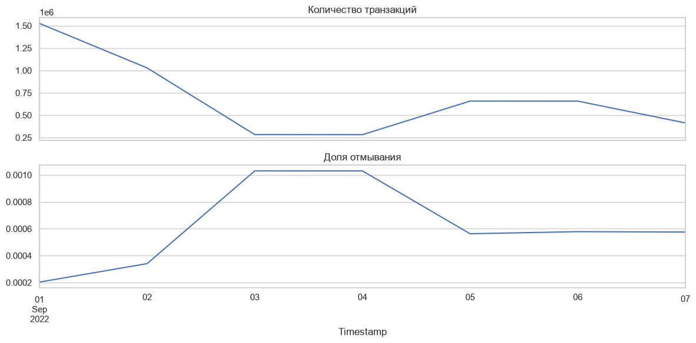

# Данные: IBM AML

В проекте используются синтетические банковские транзакции из
[IBM Transactions for Anti Money Laundering](https://www.kaggle.com/datasets/ealtman2019/ibm-transactions-for-anti-money-laundering-aml/data).
В каждой строке описан платёж и указано, связан ли он с отмыванием денег.
Это позволяет обучать модель с известной целевой меткой.

Для основного эксперимента выбран `LI-Small`. У IBM есть и другие варианты:
`HI-Small`, `HI-Medium`, `HI-Large`, `LI-Medium` и `LI-Large`.
LI и HI обозначают меньшую и большую долю незаконных операций;
Small, Medium и Large — размер набора.

## Почему данные непростые

Положительных меток очень мало, а состав транзакций меняется по времени.
Поэтому высокая accuracy мало говорит о полезности модели: почти всегда
предсказывая обычный платёж, можно получить большую долю правильных ответов
и пропустить отмывание.

Вот как менялись объём и доля положительных транзакций в train сохранённого
эксперимента:



Это наблюдение из конкретного набора, а не оценка реальных банков.
Для модели мы смотрим прежде всего на Average Precision, precision и recall.

## Что находится в строке

| Поле | Тип после валидации | Значение |
|---|---|---|
| `Timestamp` | datetime | Время транзакции |
| `From Bank` | string | Банк отправителя |
| `Account` | string | Счёт отправителя |
| `To Bank` | string | Банк получателя |
| `Account.1` | string | Счёт получателя |
| `Amount Received` | numeric | Полученная сумма |
| `Receiving Currency` | string | Валюта полученной суммы |
| `Amount Paid` | numeric | Отправленная сумма |
| `Payment Currency` | string | Валюта отправленной суммы |
| `Payment Format` | string | Формат платежа |
| `Is Laundering` | int8, 0 или 1 | Целевая метка |

Счёт рассматривается вместе с банком: одинаковый номер в двух банках
не означает одну сущность. В исходном CSV оба счёта могут называться `Account`;
pandas переименовывает второй столбец в `Account.1`.

В таблице нет уникального ID транзакции. Поэтому одинаковые строки
не удаляются автоматически — это могут быть повторные реальные платежи
в рамках синтетического потока.

## Как получить и подготовить файл

```bash
python3 scripts/download_dataset.py
```

Перед первым запуском нужен настроенный Kaggle CLI.
[Установка, авторизация и запуск ETL](ETL.md).

Исходный файл сохраняется в `data/raw/LI-Small_Trans.csv`, подготовленные
splits — в `artifacts/runs/<run_id>/data/`. Эти папки исключены из Git.

## Как связаны данные и опубликованные результаты

Сохранённый полный эксперимент обработал 6 924 041 строку из локального
`data/processed/raw.parquet`. Его равенство заново скачанному CSV отдельно
не подтверждено. Новый ETL-run фиксирует SHA256 фактически использованного файла,
чтобы последующие эксперименты можно было сравнивать по источнику.

В датасете нет времени окончания расследования или получения метки.
Исследовательский OTE предполагает немедленную доступность меток.
Это ограничение нужно учитывать при переносе модели в рабочую систему.

[Результаты эксперимента](../reports/full/RESULTS.md) · [Вернуться к README](../README.md)
