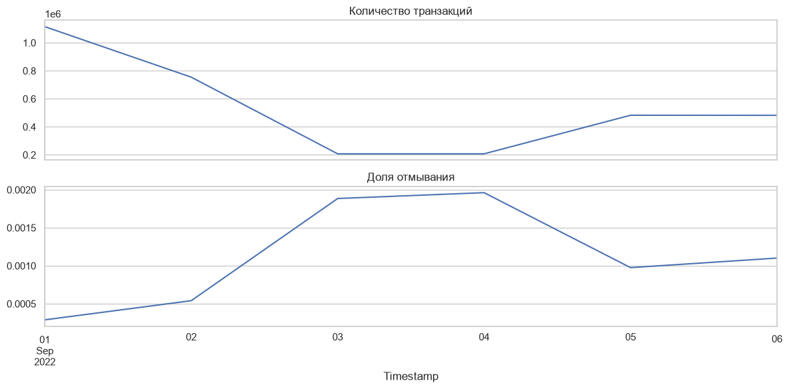

# Датасет IBM AML

Данные синтетические, это [IBM Transactions for Anti Money Laundering](https://www.kaggle.com/datasets/ealtman2019/ibm-transactions-for-anti-money-laundering-aml/data) с Kaggle. Каждая строка это один платёж и метка, отмывание это или нет. Метка известна, поэтому можно обучать обычный классификатор.

Всего вариантов шесть: `HI-Small`, `HI-Medium`, `HI-Large`, `LI-Small`, `LI-Medium`, `LI-Large`. HI и LI это больше или меньше доля отмывания, Small/Medium/Large это размер. Сначала я брал `LI-Small`, сейчас основной прогон на `HI-Small`: 5 078 345 транзакций с 1 по 18 сентября 2022, из них 5177 отмывание (0.10%).

## В чём сложность

Положительных очень мало, и картина меняется от дня к дню. Accuracy тут бесполезна: если всегда говорить «обычный платёж», accuracy будет 99.9%, а отмывание не найдётся вообще. Поэтому я смотрю на Average Precision, precision и recall.

Вот сколько было транзакций и какая доля отмывания по дням в warmup + train на HI-Small:

Объём по дням сильно скачет (от 1.1 млн 1 сентября до 0.2 млн 3–4 сентября), а доля отмывания меняется в 6 раз. В конце симуляции есть хвост, где обычных транзакций почти нет, его ETL выкидывает (подробнее в [ETL.md](ETL.md#разбиение-по-времени)).

Что ещё видно в train (подробнее в `notebooks/01_eda.ipynb`):
- 83% отмывания приходится на формат ACH, а у Wire и Reinvestment положительных нет вообще. Из-за этого модель потом находит отмывание только в ACH.
- Из валют выделяется Saudi Riyal: доля отмывания в 3.5 раза выше средней.
- У половины отправителей 1–2 транзакции, а у самого активного больше 101 тыс.

Это только про этот синтетический набор, про реальные банки отсюда ничего не скажешь.

## Колонки

| Поле | Тип после проверки | Что это |
|---|---|---|
| `Timestamp` | datetime | время транзакции |
| `From Bank` | string | банк отправителя |
| `Account` | string | счёт отправителя |
| `To Bank` | string | банк получателя |
| `Account.1` | string | счёт получателя |
| `Amount Received` | numeric | сколько получили |
| `Receiving Currency` | string | в какой валюте получили |
| `Amount Paid` | numeric | сколько отправили |
| `Payment Currency` | string | в какой валюте отправили |
| `Payment Format` | string | формат платежа |
| `Is Laundering` | int8, 0 или 1 | целевая метка |

Счёт всегда беру вместе с банком: один и тот же номер в двух разных банках это разные счета. В CSV обе колонки со счетом называются `Account`, pandas сам переименовывает вторую в `Account.1`.

ID транзакции нет. Поэтому одинаковые строки я не удаляю, это вполне могут быть два настоящих одинаковых платежа (в HI-Small таких всего 9).

## Как скачать

Как настроить Kaggle CLI, скачать HI-Small и запустить ETL, написано в [ETL.md](ETL.md#откуда-взять-данные). Скрипт `scripts/download_dataset.py` пока качает только LI-Small.

Сырой файл лежит в `data/raw/`, подготовленные данные в `artifacts/runs/<run_id>/data/`. Обе папки в git не попадают.

## Откуда какие цифры

- Текущие результаты (HI-Small) в выводах ноутбуков и в [README](../README.md). Каждый ETL run записывает SHA256 исходного файла, так что видно, на каких именно данных был запуск.
- В `reports/` лежит старый полный эксперимент на LI-Small: 6 924 041 строка из локального `data/processed/raw.parquet`. Совпадает ли он один в один с CSV, который скачивается сейчас, я не проверял.

Ещё в датасете нет информации, когда закончилось расследование и метка стала известна. OTE считает, что метки известны сразу. Для реальной системы это так не работает, надо помнить.

[README](../README.md) · [ETL](ETL.md)
